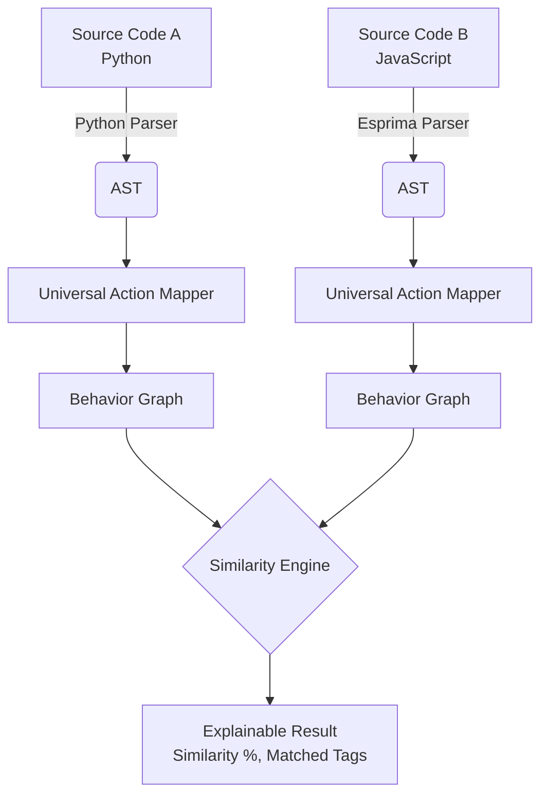

# Poly-Scan

**A static cross-language behavioral similarity and analysis tool.**

## Overview

Traditional antivirus solutions often rely on signature-based scanning, meaning they analyze the raw syntax (or specific byte sequences) of a file. However, threat actors bypass these tools by rewriting the exact same malware into a different language (e.g., translating a Python script to JavaScript). The resulting file has completely different syntax, evading signature detection, even though the underlying behavior is identical.

**Poly-Scan** solves this by shifting the analysis from *syntax* to *behavior*. It parses source code into an Abstract Syntax Tree (AST), extracts universal behavioral action tags (like `EXEC_SYS_CMD` or `FILE_WRITE`), constructs a language-independent behavioral dependency graph, and compares these fingerprints across languages.

> **Important Security Disclaimer:** Poly-Scan is purely a static analysis tool. It **never** executes, dynamically imports, spawns, or evaluates submitted source code. All code is treated as untrusted text. Furthermore, Poly-Scan does *not* detect all malware, replace antivirus software, or prove that code is malicious. High behavioral similarity simply highlights equivalent functional sequences.

---

## Architecture

Poly-Scan uses a clean separation of concerns, ensuring parsers, analyzers, and visualizers do not mix responsibilities.



### Full Analysis Pipeline
1. **Source Code & Language Detection:** The user provides two scripts and selects their respective languages.
2. **AST Parsing:** Language-specific parsers generate syntax trees without execution.
    - *Python:* Uses the built-in `ast` module.
    - *JavaScript:* Uses the `esprima` parser.
3. **Universal Behavioral Tags:** The ASTs are mapped to language-agnostic tags (e.g., `os.system` and `child_process.exec` both become `EXEC_SYS_CMD`).
4. **Behavior Graph:** A sequential directed graph is built representing the flow of actions.
5. **Similarity Engine:** Calculates a Jaccard-like index for tag matches and a Longest Common Subsequence (LCS) for sequence similarity.

---

## API & WebSocket Integration

The backend is built with **FastAPI** and provides two primary endpoints:

1. **REST API (`POST /api/v1/analyze`)**
   Accepts standard JSON payloads and returns the complete graph structure and similarity score.
2. **WebSocket (`ws /api/v1/ws/analyze`)**
   Streams live progress of the pipeline, perfect for interactive UI feedback.

*Streaming Stages:*
- `Parsing Code A...`
- `Parsing Code B...`
- `Extracting behavioral actions...`
- `Building behavior graphs...`
- `Comparing behavioral fingerprints...`
- `Analysis complete.`

---

## Installation & Setup

### 1. Backend
Ensure you have Python 3.10+ installed.

```bash
cd backend
pip install -r requirements.txt
# Start the FastAPI server
python -m uvicorn app.main:app --port 8000
```

### 2. Frontend
Ensure you have Node.js and NPM installed.

```bash
cd frontend
npm install
# Start the React Vite dev server
npm run dev
```

The frontend will start at `http://localhost:5173` and automatically connect to the backend API.

---

## Example Cross-Language Analysis

**Code A (Python)**
```python
import base64
import subprocess
payload = base64.b64decode("xyz")
subprocess.Popen(payload)
```

**Code B (JavaScript)**
```javascript
const payload = Buffer.from("xyz", "base64");
child_process.spawn(payload);
```

**Result:**
- Both map to `[DECODE_PAYLOAD]` followed by `[PROCESS_EXEC]`.
- **Similarity:** 100% Behavioral Sequence Match.

---

## Testing
Poly-Scan includes a robust backend test suite covering edge cases, malformed inputs, cross-language comparisons, and API routing.

**Current Test Results:**
- **27 tests passed, 0 failed.**

To run tests:
```bash
cd backend
$env:PYTHONPATH="."
python -m pytest tests
```

---

## Current V1 Limitations

- **Alias / Deep Reference Tracking:** In JavaScript, the AST mapper expects direct calls (e.g., `child_process.exec()`). If a script heavily obfuscates or re-assigns variables (`let runner = child_process; runner.exec()`), the simple V1 mapper will miss it.
- **Simplified Control-Flow:** Loops and conditionals are currently flattened into a linear sequence graph.
- **Limited Mappings:** Only a foundational subset of behaviors (`EXEC_SYS_CMD`, `FILE_WRITE`, etc.) are mapped in V1.
- **Frontend Editor:** The frontend uses standard `<textarea>` elements without full syntax highlighting (like Monaco) to keep the MVP lightweight.

## Future Roadmap
- Expand universal tag dictionary to cover registry edits, web requests, and crypto actions.
- Implement proper Directed Acyclic Graph (DAG) construction mapping nested conditionals (if/else).
- Integrate advanced alias tracking via static taint-analysis algorithms.
